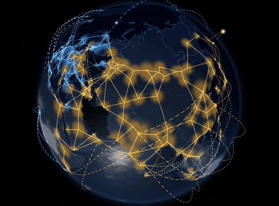
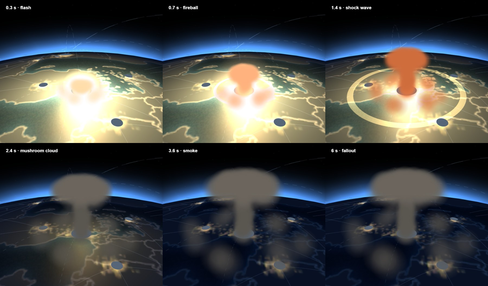

# Supply Lines

**A free browser war of logistics. Two factions, one shared planet, no sign-up.**
Open the page and you are on the front line.



> *"Shall we play a game?"*
>
> Inspired by **WarGames** (1983), the film where a teenager breaks into a military computer,
> asks to play *Global Thermonuclear War* and almost starts a real one. The computer's last lesson,
> *"the only winning move is not to play"*, is built into this game: a nuclear strike is possible,
> but a second one in the same season is nuclear winter and **everybody loses**.

Play: **[globalwar.xyz](https://globalwar.xyz)** · World report: **[globalwar.xyz/world](https://globalwar.xyz/world)**

---

## The idea

The world is a network of 184 cities linked by land, sea and air routes on a 3D globe.
You do not move armies across a map: you run **supply lines**. Every city in your colour produces troops,
convoys carry them along routes, and a city cut off from your capital and megahubs stops producing.

The map is the real world with three changes:

- **Russia is gone.** The nations it held are free (Ichkeria, Tatarstan, Bashkortostan, Siberia, the Far East and others),
  drawn with their real regional borders. Each faction can win them over with diplomacy, or take them by force and be remembered for it.
- **Where Muscovy was, there is now a sea.**
- **Iran and North Korea** are a black void that no route can cross.

## Features

| | |
|---|---|
| **Shared live world** | One server-authoritative world for everybody. Bots fill the ranks so the war is alive even with a single player; every human who joins replaces ten of them. |
| **Seasons** | A season is 7 game days. Points come from cities and whole regions. Take the enemy capital and hold it for 12 game hours to win at once. Your rank and XP stay with you. |
| **Fog of war** | You see enemy garrisons and convoys only near your own network. The server sends each faction only its own view. |
| **Abilities** | Fortify, sabotage, airdrop, blockade, fleets, rally points, signals, three convoy types (standard, fast, heavy). |
| **Drones, EW, blackouts** | Drone kill zones bleed enemy convoys on a city's routes; EW domes jam drones and strikes; long-range drone strikes black out a region and halve its production. |
| **Eras** | Every two real weeks the whole world enters a new era (Drone Age, Cold War, Age of Storms, Iron Road, Age of Alliances, Total Mobilisation) that bends a few rules and makes some world events likelier. |
| **Fundraisers, deepfakes, corruption** | Players chip CP into a drone fund that launches a swarm when full; a deepfake order lures enemy bots into your strongest city until a spy exposes it; a faction far ahead suffers daily corruption scandals. |
| **Intel** | Satellites lift the fog over a wide area; spies reveal an enemy city and its plans, and are caught one time in four. |
| **Canals and straits** | Suez, Bab-el-Mandeb, Panama, Gibraltar, the Bosporus and Malacca: hold the controlling city and their sea lanes close to the enemy. |
| **Doctrine** | Each season the general picks Blitzkrieg, Sea power, Air power or Diplomacy for the whole faction. |
| **Build** | Lay railways between your cities and build airfields that launch airdrops. |
| **Deception** | Decoy convoys look real to the enemy and send no troops; spies nearby expose them. Sabotage blows up railways. |
| **Unrest** | Free-nation cities taken by force stop producing for a while and may rise up; envoys win them without trouble. |
| **Weather** | Follows the real calendar: northern winter snows slow land convoys in the north, the summer monsoon in South Asia. |
| **Day and night** | Cities at night are harder to see; air defence weakens, spies slip through and sabotage lasts longer. |
| **Governors** | Hold a city you took for a game day and your name shows under it for every player. |
| **Operations** | HQ sets each faction a named operation (take 2 of 3 cities in a region by a deadline) for points and XP. |
| **Wonders** | Six unique cities, from the Space Center in Houston to the Stock Exchange in Tokyo, each with a faction-wide perk. |
| **Trade and pirates** | Trade ships pay port holders and can be plundered by fleets; pirate waters cost unescorted convoys troops. |
| **Scenarios and campaigns** | Seasons rotate themes (Pacific War, Long Winter, Age of Sail) and add up to seven-season Great Wars with scars that carry over. |
| **Free nations** | Envoys raise a nation's favour; at 100 all its free cities join you. Betrayal has a price. |
| **Resources** | Uranium feeds the nuclear program, oil speeds convoys, grain boosts production. |
| **World events** | Every game day: oil shock, solar storm, peace summit, hurricane season, disarmament talks… |
| **The bomb** | A faction project: three megahubs, uranium and command points from many players. Launch needs two commanders, a minute of air-raid siren, and can be shot down. |
| **General** | Players vote for a faction general who places strategic attack and hold marks. |
| **Squads** | Create a squad, share the invite link: friends land on your side, and coordinated hits get a combo bonus. |
| **Ranks and cosmetics** | Eight ranks with insignia; each unlocks a convoy trail every player can see. |
| **World report** | A public page with the live map, score, chronicle and leaders, made for sharing. |
| **Three modes** | **Global war**: 2-hour seasons in one shared world where ranks count. **Blitz**: 15-minute seasons in a separate world. **With friends**: a private world with the season length you pick, shared by an invite link and closed once everyone has left. A landing page leads to a mode screen with all three and who is playing in each. |
| **Optional Google sign-in** | Play anonymously, or sign in to keep your rank, XP and trail on every device and pick your own callsign (once per season; letters, digits, spaces and - _ . only, no taken, reserved or look-alike names). Only a salted hash of the account id is stored. |
| **Ukrainian / English** | The whole interface in Ukrainian or English, picked from the browser and switchable at any time (UA/EN button). |
| **Season replay** | Watch any past season: key moments as captions, a camera that follows the fighting, a score timeline you can scrub. |
| **Push alerts** | Optional browser notifications when your cities are attacked or a launch is detected (PWA). |



## REAL WAR

This is a game. In Ukraine the war is not.

Behind the **REAL WAR** button is a panel with real figures and their sources: the day of Russia's full-scale invasion,
missiles and drones launched at Ukraine, hours under air-raid alert, and the **live air-raid alert status in Ukraine right now**.
When there is an alert, the button blinks red. After every nuclear strike in the game, a short note reminds players
that the siren they just heard is real somewhere else.

Live data (fetched by the server and cached, no keys needed):

- Air-raid alerts by region: [ubilling.net.ua/aerialalerts](https://ubilling.net.ua/aerialalerts/)
- Daily figures of the General Staff of Ukraine: [russianwarship.rip API](https://russianwarship.rip/)

Help Ukraine: **[UNITED24](https://u24.gov.ua/)**

## Run it locally

Requires Node.js 20 or newer.

```bash
npm install
npm start
```

Open <http://localhost:5177>. Open a second browser (or a private window) to play as another person.
Add `?offline=1` to play a quick single-player world without the server.

`npm run dev` starts every mode instead: open <http://localhost:5177>, where the global war is at `/`, blitz at `/fast/`
(passed through to a second server on :5178, as nginx does in production) and private games at `/r/CODE/`. The page moves
between them without reloading (blitz saves go to `server/data/fast`).

Useful environment variables:

| Variable | Default | Meaning |
|---|---|---|
| `PORT` | `5177` | HTTP and WebSocket port |
| `SIM_SPEED` | `0.125` | Sim seconds per real second. At `0.125` a season lasts 2 hours; `1` makes it 15 minutes |
| `CP_SECONDS` | `45` | Real seconds per command point, whatever the season length. The warhead price scales with it |
| `BOTS` | `120` | Bots per faction when nobody is online |
| `DATA_DIR` | `server/data` | Where the world, players, squads and the VAPID key are saved |
| `GOOGLE_CLIENT_ID` | (empty) | Turns on optional Google sign-in, see DEPLOY.md |
| `PRIVATE_GAMES` | `3` | How many private games may run at once on the main server (each is a child process); `0` turns them off |
| `STATS_KEY` | (empty) | Opens `/stats` (daily visitors, PLAY, 5+ min, returns, JS errors) with `?key=`; always open from the server itself |
| `ALERTS_URL` | ubilling | Source of live air-raid alerts, for a mirror or proxy |
| `VAPID_SUBJECT` | `mailto:admin@supply-lines.invalid` | Contact for web push |

```bash
npm test          # engine and save/load tests
npm run balance   # 16 bot-only seasons: are the factions balanced?
```

## Trailer

`tools/trailer.js` films a 1:30 trailer (English or Ukrainian) straight from the game: scripted camera, titles, the game's own sounds and a synthesized score. The picture is rendered frame by frame at 60 fps, so it stays smooth however slow the machine is; the sound is a second, real-time pass that replays every logged game sound on the same second.

1. `node tools/trailer-server.mjs` (serves the script, pipes frames into ffmpeg, saves files to `media/`, which git ignores).
2. Open `http://localhost:5177/?offline=1&lang=en` (or `lang=uk`), press PLAY, then in the console: `T = await import('http://127.0.0.1:5199/trailer.js'); await T.run({ frames: 'http://127.0.0.1:5199', fps: 60, lang: 'en', name: 'trailer-en-video.mp4' })`.
3. Reload, press PLAY again (audio needs a click) and run `T.audio({ upload: 'http://127.0.0.1:5199/save', name: 'trailer-en-audio.webm' })`; keep the tab in front for ~95 s.
4. `node tools/trailer-mux.mjs media/trailer-en-video.mp4 media/trailer-en-audio.webm media/supply-lines-trailer-en.mp4`

## Shorts (TikTok, Reels, Shorts)

Vertical 1080×1920 clips with an AI voice-over and word-by-word captions, filmed from the game like the trailer.
Five are scripted in `tools/shorts/scripts.json` (English and Ukrainian): `capital`, `season`, `decoy`, `cipher`, `realwar`.
You need ffmpeg (`brew install ffmpeg`).

1. Voice: `node tools/shorts-voice.mjs all all`. With `ELEVENLABS_API_KEY` in `.env` it uses ElevenLabs (multilingual v2, exact word
   timings; `ELEVENLABS_VOICE`, `ELEVENLABS_VOICE_EN` or `_UK` pick the voice). Without a key it falls back to the macOS `say` voice for
   English (a draft, to check pacing) and to captions only for Ukrainian. Each short gets `media/shorts/<id>-<lang>/` with the beat audio,
   `timeline.json` and `captions.srt`.
2. `node tools/trailer-server.mjs`, then open `http://localhost:5177/?offline=1&lang=en` (or `lang=uk`), press PLAY, and in the console:
   `SH = await import('http://127.0.0.1:5199/shorts.js')`. `await SH.preview('capital', 'en')` plays it in real time to check the look;
   `await SH.run('capital', 'en')` renders it frame by frame into `media/short-capital-en-video.mp4`. Keep the tab visible while it renders.
3. Reload, press PLAY, `SH = await import(...)` again and `await SH.audio('capital', 'en')`: the game's sounds and a music bed.
4. `node tools/shorts-mux.mjs capital en` → `media/shorts/supply-lines-capital-en.mp4`: the voice on top, the game ducked under it, -14 LUFS.

A new short is a new entry in `scripts.json`: beats of one voice line each, with a scene from `tools/shorts.js` (`hook`, `front`,
`timelapse`, `capital_fall`, `capital_clock`, `capital_exile`, `decoy`, `decoy_follow`, `cipher`, `cipher_wait`, `decrypt`, `nuke`, `dark`, `outro`).

## Deploy

See [DEPLOY.md](DEPLOY.md): one `docker compose up` on a VPS, behind the reverse proxy you already run.

## How it is built

- `index.html`: the whole client (three.js globe, HUD, UI) in one file. No build step.
- `game/engine.js`: the simulation. The same code runs on the server (authoritative) and in the browser (offline mode and smooth mirroring of server snapshots).
- `server/server.mjs`: Node HTTP + WebSocket server: per-faction fog snapshots four times a second, persistence, push notifications, live real-war data, world report.
- `world.html`: the public world report.
- `net.js`: the map: cities, routes and land outlines, generated by `tools/build-net.mjs` from Natural Earth data.

Texts are written in English in the code; `i18n.js` swaps them for Ukrainian on the page. After changing or adding texts, add their translations to `tools/i18n-uk.json` and run `node tools/build-i18n.mjs` to regenerate `i18n-uk.js`.

To rebuild the map, download Natural Earth *Admin 1 – States, Provinces* (10m, GeoJSON) into `tools/data/admin1.geojson`, then run `npm run build:net`.

## Roadmap

- [x] Optional sign-in with Google to keep your rank and XP across devices (playing stays anonymous by default)
- [x] Ukrainian / English language switch
- [ ] Season replay export as a video for social media
- [ ] Twitter/X bot with season results

## Credits

- Map data: [Natural Earth](https://www.naturalearthdata.com/) and [world-atlas](https://github.com/topojson/world-atlas)
- 3D: [three.js](https://threejs.org/)
- Fonts: Unbounded and Manrope (Google Fonts)
- Inspired by *WarGames* (1983)

## License

[GNU GPL v3.0](LICENSE)
